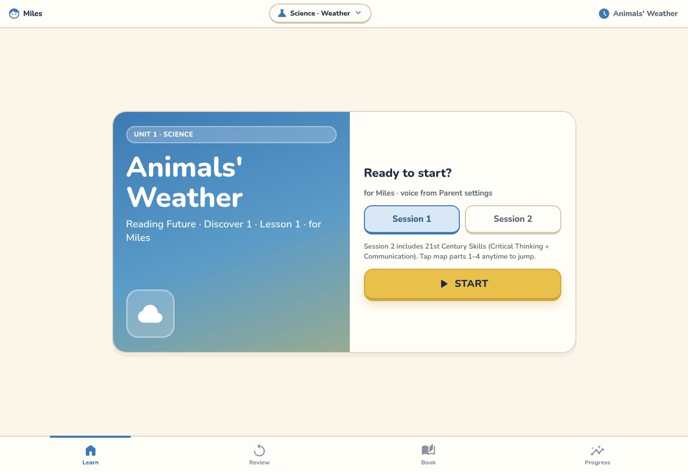
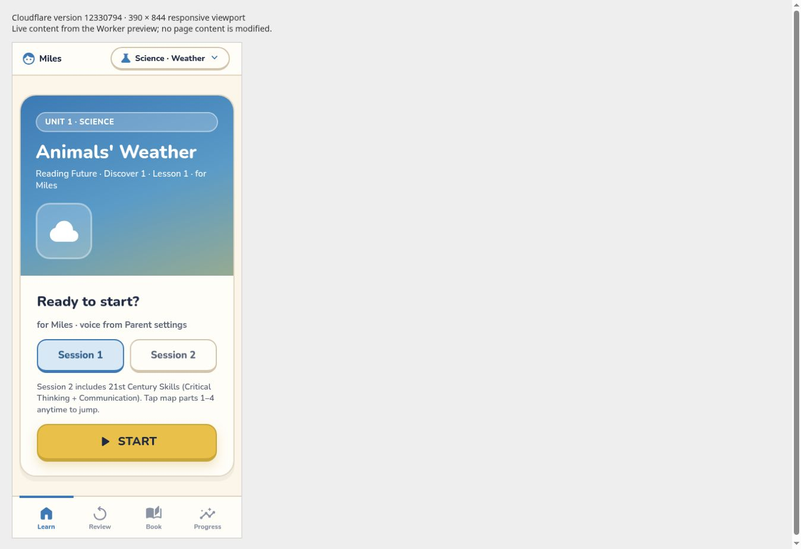
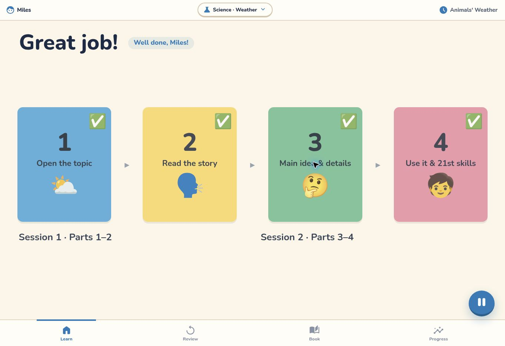
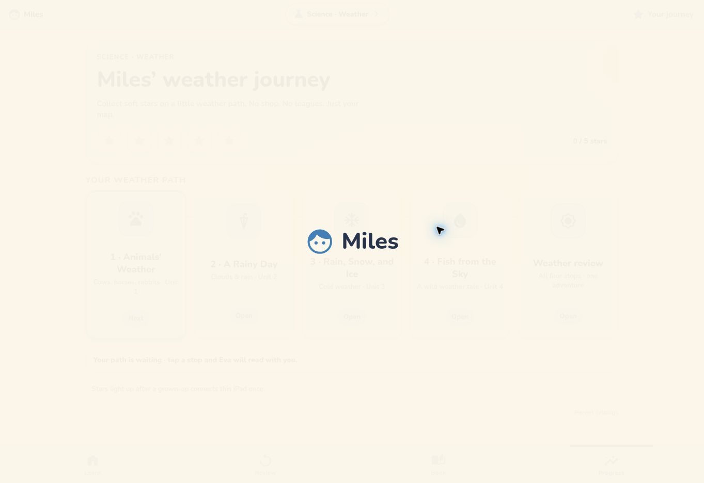

# P0: preview the existing site on Workers

Plan: [milesden/docs/PLAN.md](https://github.com/haishanlab-dev/milesden/blob/main/docs/PLAN.md).
The repositories stay separate. GitHub Pages, `CNAME`, `english.milesden.com`,
`rf-miles-progress`, its CORS policy and all production data remain unchanged.

## Local commands

Use Node 22 or later (validated on Node 24.22.1); Wrangler 4.156.0 is locked.

```sh
npm ci
npm run build
npm run dev
npm test
npm run check:deploy
```

`build` copies only the listed public pages/assets into `dist/`, byte for byte.
It does not run lesson/voice generators. `cf-progress`, tools, docs, npm files,
credentials, `CNAME` and `.nojekyll` are excluded from the uploaded directory.
`check:deploy` runs the version-upload command with `--dry-run`, without uploading
or activating a deployment. Both existing Node test suites run even if one fails.
The plan mentions Playwright; the current baseline actually contains Node tests.

## Subsequent uploads: versions only

With an authenticated Wrangler session for the intended account:

```sh
npm run deploy
```

This script remains `npm run build && wrangler versions upload --config
wrangler.jsonc`. It uploads a version without activating it. Use the actual
version preview URL and verify it. The root configuration has `workers_dev: false`,
`preview_urls: true`, static assets only, no custom domains/routes, and no KV/D1/R2
or secret bindings. Never deploy `cf-progress/wrangler.jsonc` as part of P0.

Haishan approved one initial activation on 2026-10-31 solely to initialize
`xiangxiang-english` and enable version previews. That authorization has now been
used. Do not repeat an initial `wrangler deploy`, activate another version, enable
the ordinary workers.dev URL, or bind a domain without new authorization.

## Actual deployment record (2026-10-31 UTC)

Cloudflare MCP is authenticated as `haishanlab@gmail.com`; the previous statement
that Cloudflare was not logged in is obsolete. Local Wrangler has no CLI
credential. Creating a temporary account-wide Workers Scripts Write API token
was rejected by automatic approval review; no such token was created.

Instead, the existing authenticated Cloudflare MCP performed the equivalent
Workers API operations, with a short-lived asset-upload-session JWT for file
transfer. **The actual deployment did not run `wrangler deploy` or `wrangler
versions upload` locally.** This method difference is explicit for review; the
repository's normal version-upload script is unchanged.

1. Created `xiangxiang-english` with `subdomain.enabled: false` and
   `subdomain.previews_enabled: true` before uploading any version.
2. Uploaded a manifest and all assets through the static-assets upload API.
3. Performed one `PUT /workers/scripts/xiangxiang-english` initial activation.
4. Reused the uploaded assets (the next manifest returned zero upload buckets),
   then performed `POST /workers/scripts/xiangxiang-english/versions`.
5. Read back settings, version metadata, deployments and Worker references.

| Item | Verified value |
| --- | --- |
| Worker ID | `c5e1e319edd4460cbed5b5d9283f2260` |
| Initial version | `f4f3eb55-3e8b-4076-b39f-1e0efae41eba` |
| Initial deployment | `4f726226-d364-4ea3-aec2-67ab5c9ec482` |
| Initial activation time | `2026-10-31T14:35:22.932547Z` |
| Preview-only version | `12330794-426e-45d1-832d-4964924fdc17` (version 2) |
| Version upload time | `2026-10-31T14:36:12.516763Z` |
| Deployment history after version 2 | Exactly one deployment, still using the initial version |
| Ordinary workers.dev endpoint | Disabled |
| Version previews | Enabled; version metadata `has_preview: true` |
| Bindings | Empty array |
| Custom domains / other Worker references | Empty |
| Assets routing | `auto-trailing-slash`; `not_found_handling: none`; assets served directly |

Verified in the browser:
**[P0 version preview](https://12330794-xiangxiang-english.haishanlab.workers.dev/)**.
The URL uses the returned version ID and API-provided preview suffix, following
Wrangler's own URL construction, then was opened successfully; it is not a
placeholder. No Workers Builds connection has been created.

## Validation

Source snapshot: PR #23 commit `0b566d9242d6246d1b1a91addcb62e7b446c4304`, based on
`5c5c336882b43b9a6bc043348e8917685b6179ad`. This follow-up changes documentation and
screenshots only; it does not change the uploaded static files.

- Build: 1,090 files / 74,745,774 bytes, all equal to their source files; verified
  again immediately before upload. No pre-existing tracked application file changed.
- `npm run check:deploy`: exit 0 before upload; dry run only.
- `npm test`: exit 1, same as baseline. Worker tests: 17 pass, 1 existing failure
  (`lesson pages instrument footprints and retell`), 0 skipped. Client retry/upload
  tests: all 6 pass. P0 does not hide or repair this pre-existing issue.
- Browser: every entry below loaded its actual content after the splash screen.
  These are UI checks, not claims that HTTP status codes were independently captured.

| Entry | Live browser result |
| --- | --- |
| `/` | Animals' Weather start screen |
| `/unit1-v2/` | Animals' Weather new-version start screen |
| `/unit2/` | A Rainy Day start screen |
| `/unit3/` | Rain, Snow, and Ice start screen |
| `/unit4/` | Fish from the Sky start screen |
| `/science-review/` | Weather Review start screen |
| `/book/` | Science open; future subjects visibly locked |
| `/progress/` | Weather journey, 0/5 stars without a family key |
| `/progress/parent/` | Family-key gate displayed; no key entered |
| `/voice/` | Voice demo start screen |
| `/review/` | Redirected to `/science-review/` |
| `/21st/` | Redirected to `/?s=B&part=4` |

Animals' Weather Session 1 and Session 2 were traversed using the Start button,
part navigation and right-arrow keyboard controls through `Great job! Well done,
Miles!`. This verifies the page flow, not all exercises, complete audio playback,
recording, scoring or sync. Desktop capture is 1363×936. The mobile capture shows
the actual Worker inside a 390×844 iframe in a local QA-only wrapper; it is a
responsive-width check, not a real mobile device or Safari emulation. The wrapper
was not uploaded to the Worker.

### Outstanding checks / expected limitations

- Exact 404 status: attempted `/p0-missing-20261031`; browser navigation returned
  `net::ERR_HTTP_RESPONSE_CODE_FAILURE`, then its internal error page could not
  be inspected under the browser URL policy. Command-line requests were rejected
  with HTTP 403 / Cloudflare error 1010, including valid pages. **Do not mark the
  missing-path HTTP 404 assertion as passed.** Configuration `none` is verified;
  an independent network-status check remains for review.
- Real iPad Safari audio, touch, recording and full exercise interactions remain
  unverified and need the actual device.
- Preview origins are not in the production API's CORS allowlist. Progress and
  recording sync failure is expected during P0. No real family key was entered;
  no production API, CORS or data was changed. P1 will handle integration.
- `rf-miles-progress` updated/deployed timestamps remained
  `2026-10-26T15:20:05.763822Z` after this deployment.

## Screenshots

Before/after local static comparisons from the initial PR:
[desktop](p0-review/desktop.jpg) · [mobile](p0-review/mobile.jpg).

Actual Cloudflare version preview:






## Workers Builds — settings only, not connected

After haishan separately approves a connection, configure this repository only:

| Setting | P0 value |
| --- | --- |
| Repository | `haishanlab-dev/rf-d1-aw-lesson1` |
| Worker | `xiangxiang-english` |
| Root | Repository root |
| Branch | `main` (only haishan merges) |
| Build command | `npm run build` |
| Deploy / preview command | `npm run deploy` (version upload only) |
| Build variable | `NODE_VERSION=24.22.1` |

Do not enable active deployments or change domains. Preview verification does
not prove automatic production deployment. That gate remains pending approval
and a later merge/build verification. Stop at P0.

Rollback for this preview is to stop using its URL; the production Pages site and
data have not moved. Any resource deletion should be reviewed separately.

References: [Direct asset upload](https://developers.cloudflare.com/workers/static-assets/direct-upload/),
[Build settings](https://developers.cloudflare.com/workers/ci-cd/builds/configuration/),
[Version URLs](https://developers.cloudflare.com/workers/versions-and-deployments/version-urls/).
