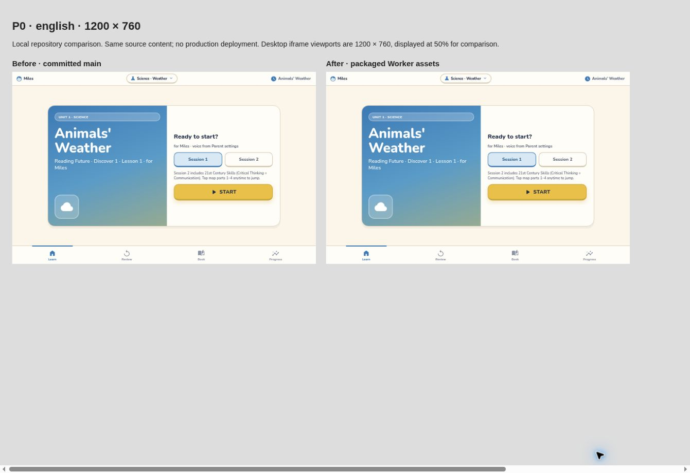
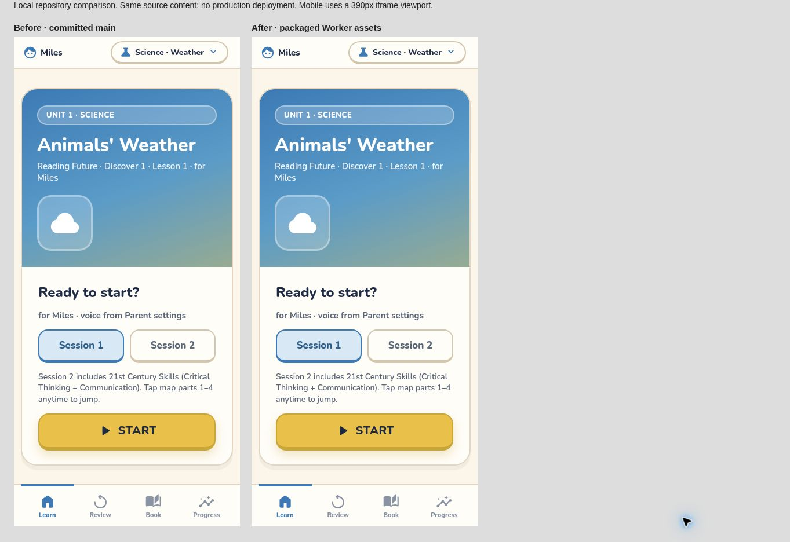
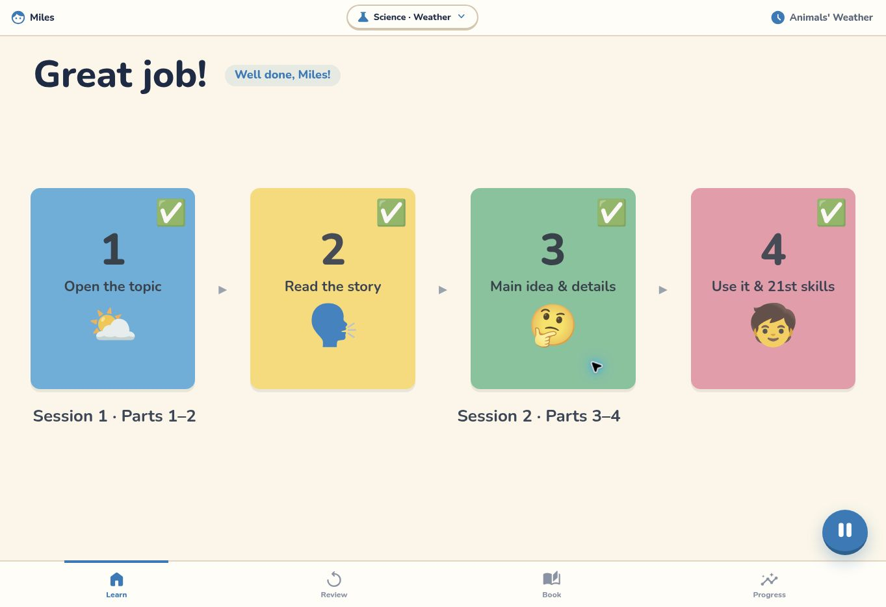
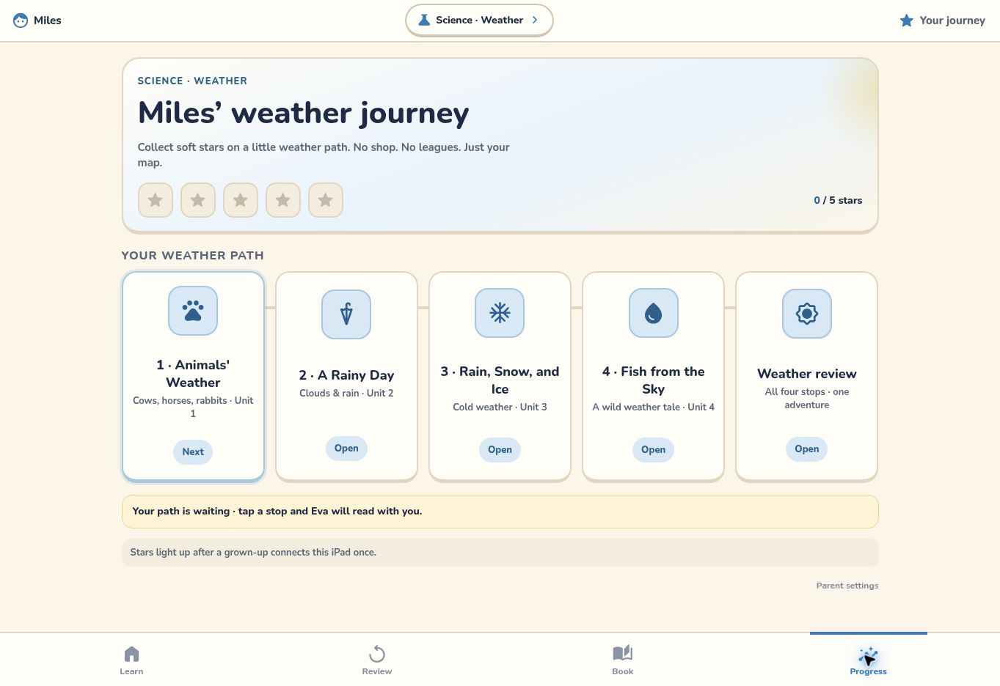

# P0: preview the existing site on Workers

Plan: [milesden/docs/PLAN.md](https://github.com/haishanlab-dev/milesden/blob/main/docs/PLAN.md).
This repository stays separate. GitHub Pages and `CNAME` remain unchanged.

## Local commands

Use Node 22 or later (validated on Node 24.22.1). Wrangler is pinned in the lockfile.

```sh
npm ci
npm run build
npm run dev
npm test
npm run check:deploy
```

`build` copies the existing public pages and assets byte for byte into `dist/`.
It does not run the lesson/voice generators. Only listed public paths are copied;
`cf-progress`, tools, docs, npm files and local credentials are not public assets.
GitHub Pages metadata (`CNAME`, `.nojekyll`) stays in the repository.

`check:deploy` runs Wrangler's dry run and does not upload or activate anything.
`npm test` always runs both existing Node test suites. The baseline failure
`lesson pages instrument footprints and retell` is retained, not skipped or fixed.
Despite the plan's wording, the current main branch contains Node tests, not a
Playwright suite/configuration.

## Preview upload only

After authenticating to the intended Cloudflare account:

```sh
npm run deploy
```

In P0, `deploy` deliberately means `wrangler versions upload`: it uploads a version
and returns a Version URL without promoting it to an active deployment. Use the
URL actually returned by Wrangler; do not guess a hostname. `workers_dev: false`
and `preview_urls: true` keep the normal workers.dev route disabled while allowing
Version URLs. There are no custom-domain routes, KV, D1, R2 or secret bindings in
the new root config. Never deploy `cf-progress/wrangler.jsonc` as part of P0.

If the account requires an initial Worker deployment before it can upload a
version, stop and ask haishan; do not fall back to `wrangler deploy`.

The page still calls the existing `rf-miles-progress` API. Its CORS allowlist does
not include Version URL origins. Therefore cross-origin progress/recording sync
is not accepted from this preview in P0; do not enter a real family key or change
the production API/CORS to make preview testing pass. Same-origin API integration
and data migration belong to P1. Local browser state is separate by origin.

## Workers Builds connection

Connect **this repository only** to Worker **xiangxiang-english** in the existing
Cloudflare account. First check whether that Worker or connection already exists.

| Setting | P0 value |
| --- | --- |
| Repository | `haishanlab-dev/rf-d1-aw-lesson1` |
| Root directory | repository root |
| Branch | `main` (only haishan merges) |
| Build command | `npm run build` |
| Deploy command | `npm run deploy` (version upload only during P0) |
| Preview command | `npm run deploy` (version upload only) |
| Build variable | `NODE_VERSION=24.22.1` |

Workers Builds installs dependencies from the lockfile. Keep preview builds
enabled for PR branches. Config changes alone do not connect GitHub, authenticate
Cloudflare, or prove an automatic deployment. Record the actual build and Version
URL in the PR after account setup. No credentials belong in repository files.

Before enabling active deployments or changing any domain, obtain haishan's
explicit approval. P0's automatic-production-deployment gate remains pending
until that approval and a merge/deployment verification; a preview is not proof.

## Review and rollback

On the Version URL check `/`, `/unit1-v2/`, `/unit2/`, `/unit3/`, `/unit4/`,
`/science-review/`, `/book/`, `/progress/`, `/progress/parent/`, `/voice/`,
`/review/` and `/21st/`; check a missing URL returns 404, then complete a lesson.
Attach desktop/mobile before-and-after screenshots to the PR. iPad Safari audio
and touch still require a real device. Record unperformed checks explicitly.

Until an active deployment/domain change is approved, rollback is simply to stop
using the preview: the production Pages site and data have not moved.

## Validation record (2026-10-31)

Base: `5c5c336882b43b9a6bc043348e8917685b6179ad`; Node 24.22.1, Wrangler 4.156.0.

- `npm run build`: 1,090 files / 74,745,774 bytes; every output file matches its
  source byte for byte. All existing tracked files remain unchanged.
- `npm run check:deploy`: exact preview-upload command with `--dry-run` exits 0.
  No version was uploaded and no deployment was activated.
- `npm test`: exits 1 as expected. Worker suite 17 passed / 1 known failure /
  0 skipped; client retry/upload suite all 6 passed. Same results before changes.
- Local static preview: opened homepage and progress; navigated both sessions of
  Animals' Weather from start through the final screen using keyboard navigation.
  This does not verify every exercise, complete audio playback, recording, or sync.
- Desktop before/after screenshots use 1200 × 760 iframe viewports displayed at
  50%; mobile uses 390 × 844. The compared pages render consistently.
- Cloudflare Version URL, Workers routing/404 behavior, live sync and real iPad
  Safari checks remain unverified. Cloudflare authentication is unavailable in
  the current session. Workers Builds has not been connected.

Ephemeral local QA: `http://terminal.local:4173/`,
`http://terminal.local:4173/__p0_review__/english-desktop.html`, and
`http://terminal.local:4173/__p0_review__/english-mobile.html`.
These URLs are local static previews, not Cloudflare Version URLs.






References: [Build settings](https://developers.cloudflare.com/workers/ci-cd/builds/configuration/)
and [Version URLs](https://developers.cloudflare.com/workers/versions-and-deployments/version-urls/).
